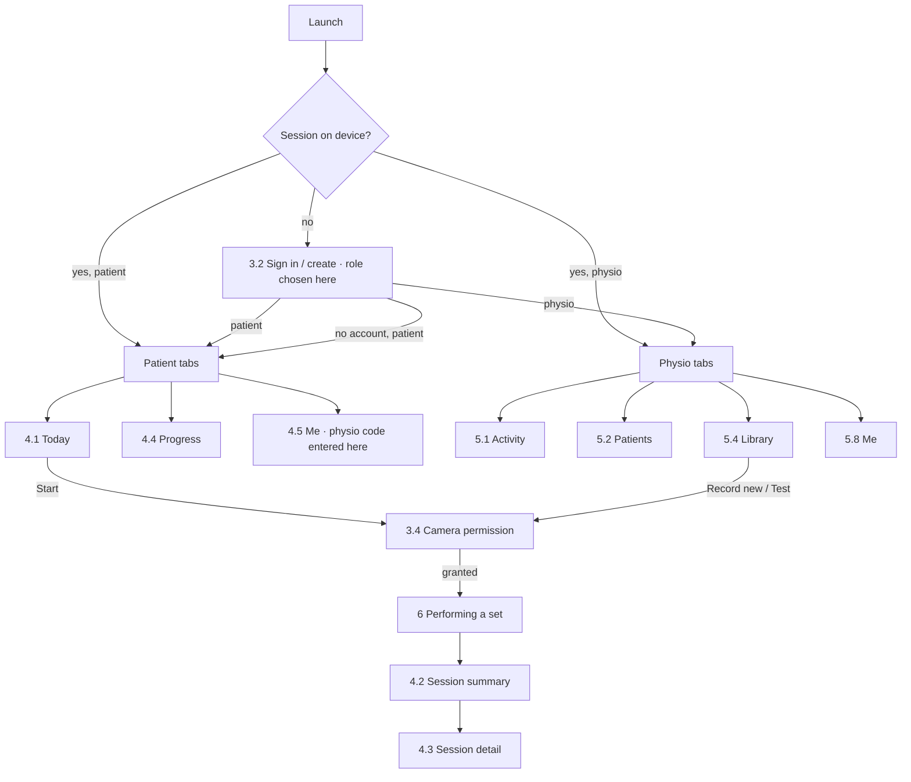
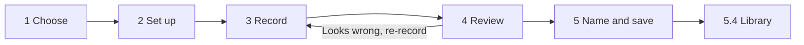

# RightPosture — Navigation Flow

How a person moves through the app: every screen's entry points, its exits, and what happens when
something goes wrong. Companion to [UI-SCREENS.md](UI-SCREENS.md), which says what each screen
*contains*; this one says how you *get there* and where you can go next.

> **This describes the target architecture**, matching the screen numbering in UI-SCREENS.md §7.
> Exact strings and thresholds live in [UI-CONTENT.md](UI-CONTENT.md).

---

## 1. Flow rules

These hold everywhere and are not repeated per screen.

1. **Tabs never stack.** Switching tabs replaces the whole content area — each tab keeps its own
   back-stack, so returning to a tab returns you where you left it.
2. **Full-screen flows suspend the tab bar.** Recording an exercise (5.5), performing a set (6) and
   onboarding (§3) take over the screen. There is exactly one way out of each, and it is always in
   the same place.
3. **A set is never lost to navigation.** During §6, system back and the escape action both route to
   *Finish set* — which still produces a summary from whatever was captured. Abandoning is a
   deliberate, confirmed choice, never a slip.
4. **Every dead end names its exit.** Empty states, permission blocks and failures each carry the
   one action that resolves them (UI-SCREENS.md §1, principle 4).
5. **Skipping is a real path.** A patient can reach a set without an account and without a physio
   link. No flow may make either mandatory.
6. **Depth budget: 3 taps to anything.** Today → Start → set → summary is three. Activity → patient
   → tab is three. Anything deeper needs a shortcut from a home screen.

---

## 2. Top-level map

---

## 3. Launch and onboarding

### 3.0 Cold start routing

The launch decision runs before any screen paints. It reads only local state, so it works offline.

| Local state | Lands on |
|---|---|
| No role chosen | **3.2 Sign in / create account** |
| Role = patient | **4.1 Today** |
| Role = physio | **5.1 Activity** |

A signed-out patient with local sessions still lands on Today, and so does a patient with no physio
link. Losing a server connection never sends someone back through onboarding.

### 3.1 Role choice — *part of sign-in*

There is no separate role-picker screen. The role is chosen on 3.2 alongside the credentials, so
first launch is one screen rather than two, and the choice can be corrected without a back press.

Changing role later is **Me → Switch role**, which is confirmed before it takes effect because it
changes which app this is.

### 3.2 Sign in / create account

| | |
|---|---|
| **Entered from** | First launch · **Me → Sign in** when signed out · **Me → Switch role**. |
| **Contains the role choice** | Patient or physio, picked here (§3.1). |
| **Exits** | *Sign in / create* (patient) → 4.1 Today · *(physio)* → 5.1 Activity · **Continue without an account** → the same two destinations |
| **Back** | None on first launch — it is the root. From Me, back returns to Me unchanged. |
| **Failure** | Wrong credentials or no network: stay on screen, inline message, and **Continue without an account** stays available — a patient must never be blocked from training by a login server. |

Entering from Me returns to Me on success, not to a home screen.

### 3.3 Link to your physio — *part of Me*

Not an onboarding step. A patient can use the app indefinitely without one, so the code entry lives
on **4.5 Me** as *"Change clinic or enter referral code · Link New"* rather than standing between
first launch and the first set.

| | |
|---|---|
| **Entered from** | **4.5 Me → Link New**. |
| **Exits** | *Code accepted* → back to Me, showing the linked physio; the newly prescribed exercises appear on 4.1 Today · *Cancel* → back to Me unchanged |
| **Failure** | Invalid or expired code: inline message naming the fix (*ask your physio for a new code*), and the field keeps its contents. |

Linking is never a gate. Today works, Progress works, and sets are recorded locally whether or not a
physio is ever attached.

### 3.4 Camera permission

Not a destination anyone navigates *to*; it is a gate in front of §6 and 5.5.

| | |
|---|---|
| **Entered from** | Any attempt to start a set (4.1) or record/test an exercise (5.4). |
| **Exits** | *Granted* → straight through to the screen that asked · *Denied* → back to the caller, which keeps its Start action visible · *Blocked permanently* → the settings-pointing copy, plus a **Back** to the caller |
| **Rule** | The explanation shows **before** the system dialog, once. A second attempt goes straight to the system dialog, or to the blocked copy. |

---

## 4. Patient flows

### 4.1 Today — patient home

| | |
|---|---|
| **Entered from** | Launch (default) · the Today tab · returning from a session summary (4.2). |
| **Exits** | Card **Start** → 3.4 → **6** · card body, when already done today → 4.3 for that set · empty-state action → 4.5 Me |
| **Back** | Root of its tab; system back from here exits the app. |
| **Empty state** | No prescribed exercises → one action: *Link a physio*, which lands on 4.5 Me with the code entry (3.3) open, or, if already linked, a line saying the physio has not prescribed anything yet. |

### 4.2 Session summary — post-set

| | |
|---|---|
| **Entered from** | **6**, on *Finish set* — automatically, never by a tap the patient has to find. |
| **Exits** | *Done* → **4.1 Today** · *See full detail* → 4.3 · *Repeat this exercise* → 3.4 / **6** again |
| **Back** | Behaves as *Done*. The set screen has left the stack — you can never reverse into a finished set. |
| **Degraded case** | Nothing scoreable: the hero renders as *not scored* with its reason, and the next-step line still appears. It is never skipped. |

### 4.3 Session detail — tabbed (Summary / Reps / Form)

| | |
|---|---|
| **Entered from** | 4.2 · 4.4 History · 4.1 · physio 5.1 feed · physio 5.3 Sessions |
| **Exits** | Back to whichever screen opened it. |
| **Default tab** | **Summary**, always — including when a physio opens it from the Activity feed. |
| **Deep link** | A *form slipped* marker in the physio's feed opens this screen on the **Form** tab, so the flag and its evidence are one tap apart. |

### 4.4 Progress — tabbed (Overview / Quality / Range / History)

| | |
|---|---|
| **Entered from** | Progress tab · a *See progress* link on 4.2. |
| **Exits** | History row → 4.3 · the *no goal set* state on Range → an explanation that the physio sets goals, **not** a goal editor |
| **Selector** | The exercise chip row sits above the tabs and persists across them: changing exercise keeps the current tab. |
| **Empty state** | Before any session exists, one card replaces all four tabs. |

### 4.5 Me *(patient)*

| | |
|---|---|
| **Entered from** | Me tab. |
| **Exits** | **Link New** → the code entry (3.3), which returns here · *Sign in* → 3.2 · **Switch to Physiotherapist mode** → 3.2 with the role changed, confirmed first because it changes which app this is · voice and language changes apply in place with no navigation |

---

## 5. Physio flows

### 5.1 Activity — physio home

| | |
|---|---|
| **Entered from** | Launch (default) · the Activity tab. |
| **Exits** | Flag card → **5.3**, on the tab that evidences the flag (*needs review* → Progress, *ready to progress* → Overview) · feed row → 4.3 · *recorded on this phone* row → 4.3 |
| **Back** | Root of its tab. |
| **Empty state** | No sessions yet → the action is *Invite a patient* (5.7), not a passive message. |

### 5.2 Patients

| | |
|---|---|
| **Entered from** | Patients tab · *See all patients* from the Activity flag strip. |
| **Exits** | Row → **5.3** (Overview) · **Invite a patient** → 5.7 as a sheet over this screen |
| **Empty state** | Action is *Invite a patient*. |

### 5.3 Patient detail — tabbed (Overview / Progress / Programme / Sessions)

| | |
|---|---|
| **Entered from** | 5.2 row · 5.1 flag card. |
| **Exits** | Programme → *Set a goal* → **5.6** (modal, returns here) · Programme → *Add exercise* → an assign sheet sharing 5.7's assign step · Sessions row → 4.3 · Overview → **Approve progression**, which acts in place and updates the verdict card without navigating |
| **Back** | Returns to 5.2 or 5.1, whichever opened it. |
| **Entry tab** | Overview by default; a flag deep-links to the tab holding its evidence. |

### 5.4 Library

| | |
|---|---|
| **Entered from** | Library tab. |
| **Exits** | **Record a new exercise** → 3.4 → **5.5** · row **Test** → 3.4 → **6** in test mode, whose summary returns here rather than to Today · row body → that exercise's detail and version history |
| **Empty state** | Action is *Record a new exercise*, with the line explaining that the recording becomes the reference everything is scored against. |

### 5.5 Record an exercise — full-screen wizard

Linear, five steps, no tab bar.

| | |
|---|---|
| **Entered from** | 5.4. |
| **Step back** | Each step returns to the previous one with its state intact. |
| **Exit mid-wizard** | A single **Cancel**, confirmed once past step 3 — a recording discarded by accident is expensive to redo. |
| **Step 2 override** | The calibration override advances to step 3 and names what it skipped; that note travels to step 4's watch list. |
| **Step 4 reject** | *Looks wrong — re-record* returns to **step 3**, not step 1: the choice of exercise is still valid. |
| **Step 5 name clash** | Stays on step 5 with the version warning; saving anyway creates a new version rather than overwriting. |
| **Success** | Returns to 5.4 with the new exercise at the top. It does not auto-start a test. |

### 5.6 Set a goal — modal

| | |
|---|---|
| **Entered from** | 5.3 Programme. |
| **Exits** | *Save* → 5.3 Programme, with the progression verdict on Overview recomputed · *Cancel* → back unchanged |
| **Why the flow matters** | Until this modal is completed once per exercise, every progression verdict in both roles reads *no range goal set*. It is the switch that turns the verdict card (UI-SCREENS.md §8.2) on. |

### 5.7 Invite a patient — bottom sheet

| | |
|---|---|
| **Entered from** | 5.2 · 5.1 empty state. |
| **Flow** | Code shown → *(the physio reads it aloud)* → **Assign**: which exercise, what prescription → *Done*. |
| **Exits** | *Done* → dismisses to 5.2 with the pending invite listed · dismissing early keeps the code valid; it reappears under the patient row as *invited, not yet joined* |
| **Regenerate** | Replaces the code in place and invalidates the previous one, said plainly on screen. |

### 5.8 Me *(physio)*

**Not yet designed.** It mirrors 4.5 minus the physio-link entry: account, language, switch role,
version. *Switch role* → 3.2 with the role changed, confirmed.

---

## 6. Performing a set — the protected flow

The only screen with custom navigation rules, because the patient is 2–3 m away and cannot make a
correction tap.

| | |
|---|---|
| **Entered from** | 4.1 Start (patient) · 5.4 Test (physio) — always through the 3.4 gate. |
| **Chrome** | No tab bar, no back arrow, nothing tappable at the screen edges. |
| **The one exit** | **Finish set**, in a fixed position for both the rep and the hold variant. |
| **System back** | Treated as *Finish set*. It never discards. |
| **Then** | → **4.2** (patient), or → 5.4 with a test verdict (physio test mode). The set screen leaves the stack. |
| **Safety stop** | Form degraded past the threshold: the stop banner overrides the screen but does **not** navigate on its own. The patient still ends the set deliberately, and the summary records that a stop fired. |
| **Interruption** | Backgrounded, a call, camera lost: the set closes and a summary is still produced, marked interrupted. No completed effort ever produces no record. |
| **Language** | Changing language is reachable from within the set (UI-SCREENS.md §11) and neither leaves the screen nor resets the count. |

---

## 7. Cross-cutting entry points

Screens reachable from more than one place, and what each caller expects back.

| Screen | Callers | Returns to |
|---|---|---|
| 3.2 Sign in | First launch, Me (both roles) | 4.1 / 5.1 on first launch; the calling Me otherwise |
| 3.3 Link to physio | 4.5 Me only | 4.5 Me |
| 3.4 Camera permission | 4.1, 5.4 | the caller, granted or not |
| 4.3 Session detail | 4.2, 4.4 History, 4.1, 5.1 feed, 5.3 Sessions | the caller |
| 5.6 Set a goal | 5.3 Programme | 5.3 Programme |
| 5.7 Invite | 5.2, 5.1 empty state | 5.2 |
| 6 Performing a set | 4.1, 5.4 Test | 4.2 (patient) or 5.4 (physio test) |

---

## 8. Failure and offline paths

Every one of these keeps the user inside the app with something to do.

| Situation | Behaviour |
|---|---|
| No network at sign-in | Stay on 3.2; **Continue without an account** remains a full path. |
| No network mid-session | The set is unaffected — scoring is on-device. The summary saves locally, syncs later, and says so. |
| Code entry offline | 3.3 says the code can't be checked right now and leaves Me exactly as it was. Nothing about the patient's own training depends on the link, so there is nothing to retry urgently. |
| Camera unavailable | 3.4 blocked copy; the caller keeps its Start action, so the retry is one tap. |
| No reference for an exercise | Start is disabled on 4.1 with the reason named; the physio sees the same on 5.4 with *Record a new version*. |
| Sync conflict on a session | The local record is never dropped; it appears in History marked *not yet synced*. |

---

## 9. Reference

- **[UI-SCREENS.md](UI-SCREENS.md)** — what each screen contains, the screen inventory, the density
  budget, and the components these flows move between.
- **[UI-CONTENT.md](UI-CONTENT.md)** — exact strings and thresholds for every state named above.
